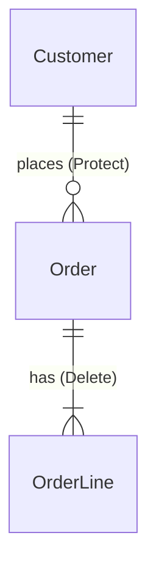

# Data model: output templates

Reference for `outsystems-data-model`, step 3. The rules are in [../SKILL.md](../SKILL.md).

**Entity proposal** (`docs/data-model/<Feature>.md`):

````markdown
# Data model: <Feature>

## Entities
| Entity | Module | Type | Definition |
| Customer | Customer_CS | Regular | A company that buys from us |
| OrderStatus | Order_CS | Static (Static folder) | Lifecycle state of an order |

## Attributes
### Order (Order_CS)
| Attribute | Type | Length | Mandatory | Notes |
| CustomerId | Customer Identifier | | Yes | Protect, indexed |
| OrderStatusId | OrderStatus Identifier | | Yes | Static, default Draft |
| Total | Currency | | Yes | |
(standard attributes: CreatedOn, CreatedBy, UpdatedOn, UpdatedBy)

## Relationships


## Decisions
| # | Decision | Reason |
| 1 | OrderStatus is static | Logic depends on Submitted/Approved; changes need a deployment |

## Open questions
- Retention period for cancelled orders (ask the product owner)
````

**Glossary** (`GLOSSARY.md`): one row per term.

```markdown
| Term | Definition | Entity | Avoid |
| Customer | A company that buys from us | Customer (Customer_CS) | Client, Account |
```
